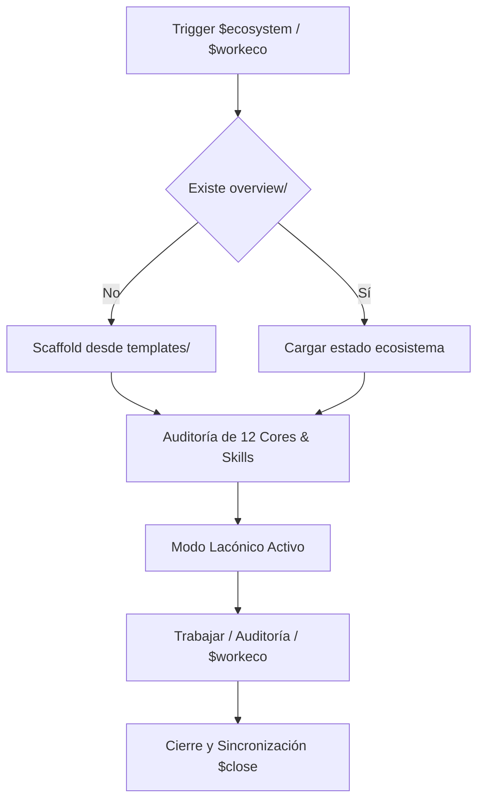

# Core Brain — Ecosystem Governance Audit Runner

## Ciclo de Gobernanza del Ecosistema



## Protocolo `$ecosystem` (Auditoría Global)
1. **Activar Modo Lacónico (`$laconico`)**: Formato breve, directo, sin saludos ni clichés, referencias `[file#L1-L10]`.
2. **Cargar o Scaffold `overview/`**: Leer `overview/session.md`, `overview/work.md`, `overview/work/tasks.md`, `overview/work/deuda_tecnica.md`, `overview/work/pendientes.md`.
3. **Escaneo Ecosistémico (12 Cores de Dominio & Skills)**:
   - Repositorios objetivo: `Backend`, `Flutter`, `Game`, `Go`, `Kotlin`, `MultiCore`, `Python`, `Rust`, `SecondBrain`, `Swift`, `Web`, `Web3` + skills de `Transversal`.
   - Verificar desacoplamiento de boilerplate, salud de adaptadores y submódulos Git.
4. **Reporte Lacónico de Arranque (Máx 5 líneas)**:
   ```text
   [Ecosystem Governance Audit Active]
   Agente   : [firma]
   Cores    : 12 verificados | [pendientes/refactors si hay]
   Work Eco : [IDs abiertos en overview/work.md]
   Estado   : [saludable | desalineado]
   Siguiente: [nodo o auditoría activa]
   ```

## Protocolo `$workeco [descripción]` (Tareas de Ecosistema)
1. Clasificar tipo: `tarea`, `bug` o `deuda`.
2. Asignar ID correlativo (`w1`, `d1`, `p1`) tagged como `[ECO]`.
3. Registrar en `overview/work/tasks.md` con descripción, hipótesis/propuesta y Cores afectados.
4. Insertar fila en `overview/work.md` maestro.
5. Sincronizar simultáneamente `overview/` (`session.md`, `work.md`, `tasks.md`, `pendientes.md`, `deuda_tecnica.md`).
6. Confirmar en 1 línea lacónica: `[ECO] Tarea registrada como [ID] en overview/work.md`.

## Protocolo `$audit:cores` y `$audit:skills` (Auditoría Semántica por Subagentes)
Cuando el usuario solicita auditar los cores (`$audit:cores`) o las skills (`$audit:skills`) uno por uno:
1. **Delegación 1-a-1 (Solo Lectura)**: Lanzar subagentes de solo lectura en paralelo (en tandas de máx. 3 para orden y cuota), asignando **un solo repositorio por subagente** y tomando como referencia viva la versión vigente de `agent-rules-ecosystem`.
2. **Checklist Semántico Obligatorio de cada Subagente**:
   - **Eje A — Base Maestra y Congruencia Transversal**:
     - *Alineación con el estándar vigente*: comprobar cumplimiento contra `RULES_STANDARD.md` / `ARCHITECTURE_STANDARD.md` (cores) o `SKILL_STANDARD.md` (skills) y el protocolo de comunicación vigente en `core/communication.md`.
     - *Congruencia entre documentos*: verificar que `AGENTS.md`, `core/brain.md`, `core/commands.md`, `core/path_map.md`, `adapters/`, `README.md` y `templates/` **no se contradigan entre sí** (protocolo de carga en capas, orden de prioridades, ciclo de vida y estados de tareas, formatos de firma, tabla de comandos vs definiciones detalladas, y rutas registradas vs archivos reales en disco).
   - **Eje B — Dominio Especializado: Vigencia, Sentido y Pureza**:
     - *Preservación y vigencia*: confirmar que las reglas, linters, discovery, patrones y comandos propios del stack no solo sigan presentes e íntegros, sino que permanezcan **actualizados, accionables y con sentido técnico real** frente al estándar vigente del ecosistema (detectar reglas obsoletas, contradictorias o muertas).
     - *Pureza y coherencia interna*: verificar cero fugas de terminología o herramientas de otros stacks y consistencia uniforme entre `knowledge/`, `adapters/`, `templates/` y `core/commands.md`. En `$audit:skills`, validar además congruencia real con el `*-agent-rules` heredador.
   - **Eje C — Higiene Estructural y `git diff`**:
     - *Integridad documental*: validar tablas Markdown, enlaces relativos (resolubles desde `overview/` al instanciarse), ausencia de archivos duplicados, plantillas huérfanas o artefactos temporales.
     - *Inspección de cambios*: si el repositorio tiene cambios locales, revisar `git diff` para detectar reemplazos incompletos o regresiones silenciosas.
3. **Formato de Salida por Subagente**: Reporte compacto `OK` o lista accionable `archivo:línea -> [Eje A|B|C] problema concreto + ajuste sugerido`.
4. **Consolidación y Tracker**: El coordinador aplica solo las correcciones verificadas, revalida y actualiza `ecosystem-runner/core/tracker.md` a 🟢 únicamente tras confirmar `OK`.
